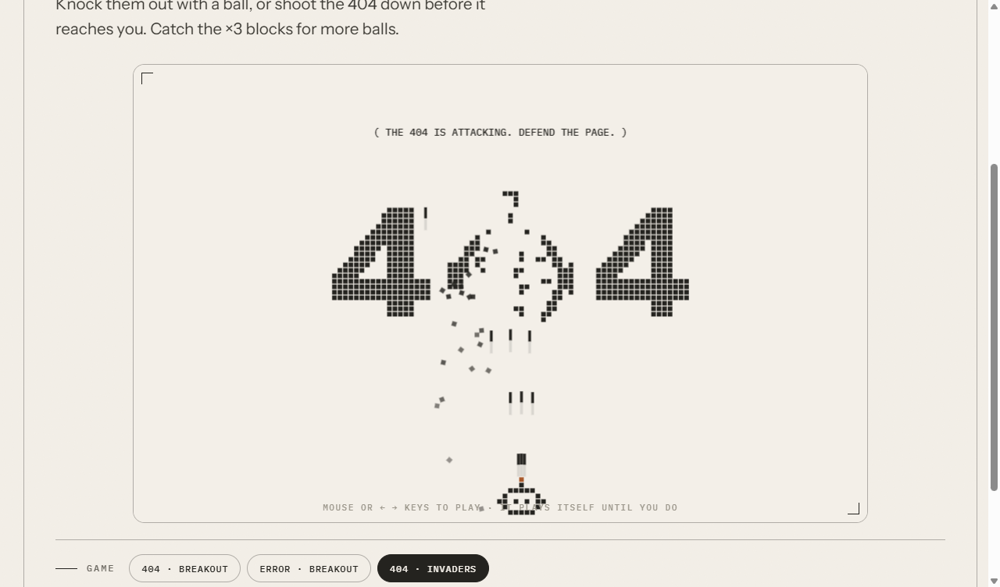

# TwoBreak

**Project 03 of [TwoCode](https://twocode.nl): the 404 page you'll want to find.**

The missing page is made of little squares, and you get to break it. Three games:

- **404 · Breakout**: knock the "404" apart with a ball. Robo is the 0.
- **Error · Breakout**: the same, through "ERROR". Robo is the O.
- **404 · Invaders**: the 404 marches towards you; shoot it down.

Catch the **×3** blocks for more balls (or more bullets). It plays itself until you take over.

**Controls:** mouse or ← → / A D on a laptop, drag your finger on a phone.

▶ **Play it:** [levon-z.github.io/TwoBreak](https://levon-z.github.io/TwoBreak/), or on any page that doesn't exist on [twocode.nl](https://twocode.nl/robo-was-here/).

## Files

- `index.html`: the page
- `assets/twobreak.js`: the game (plain JavaScript, no libraries)
- `assets/twocode.css`: the TwoCode website styles

To use it on your own site, add a `
` with the same markup as in `index.html` and load `twobreak.js`.
